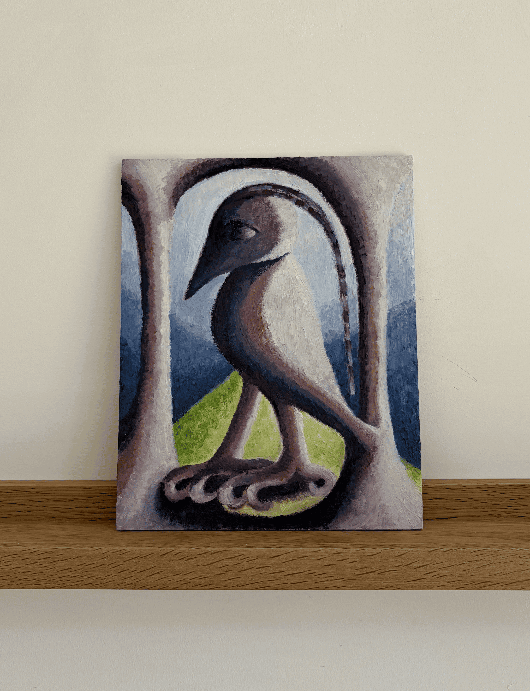

  

    

Painter living in South East London

I make paintings of strange objects, creatures, structures and staged worlds. I return to these forms because they suggest something unknown, or just beyond ordinary reality. I invent forms from observation, memory and imagination. I want my work to create a certain feeling: an uncanniness, a recognition of something that's been forgotten.

<a href="https://instagram.com/rapturebird">See new paintings on Instagram @rapturebird →</a>

<h3>Education & practice</h3>

  

    
2026/2027

    
Turps painting CC

    
Currently taking part in the <a href="https://www.turpsbanana.com/correspondence-course">Turps Correspondence Course</a>

  

  

    
2026

    
Royal Drawing School, drawing intensive

    
I did a lot of observational drawing in the spring and summer of 2026 (drawing from collections in the V&A, life drawing in the studio, engaging with drawing from different eras, cultures and continents) 

  

  

    
2019

    
Royal College of Art, MA Visual Communication

    
Amongst other things, I focused on experimental comics. Ultimately I created a series of six-panel risograph-printed comics about a fly who dies in every story. The comics were sold via an honesty box at the summer show.

    
Dissertation (distinction) on gaps, spaces and imagination.

  

  

  <aside class="about-image">
    
    
The spirit is the door, oil on wood panel, 10x8in, 2026

  </aside>

