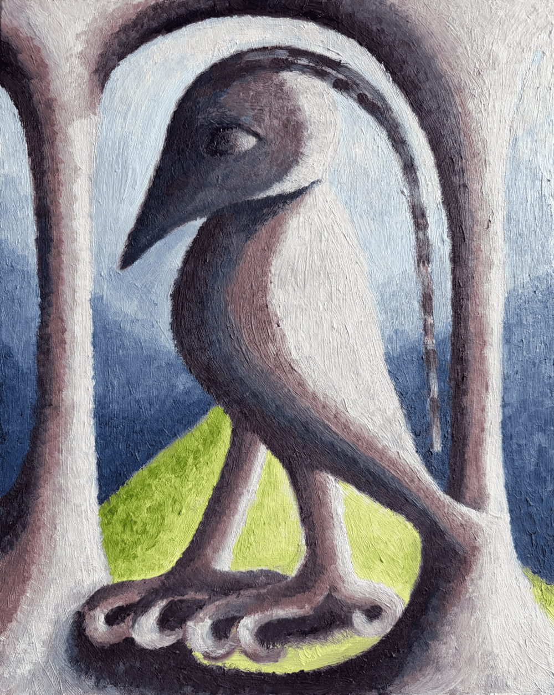

Painter living in South East London.

I make paintings of strange objects, creatures, structures and staged worlds. I return to these forms because they suggest something unknown, or just beyond ordinary reality. I invent forms from observation, memory and imagination. I want my work to create a certain feeling: an uncanniness, a recognition of something that’s been forgotten.

<a href="https://instagram.com/rapturebird">Instagram</a> is the best place to see my work right now, until I update this website. (I promise I will!)

<h3>Education / professional practice</h3>

  

    
Turps painting CC 2026/2027

    
Currently doing this

  

  

    
Royal Drawing School, drawing intensive, 2026

    
I did a lot of drawing in the spring and summer of 2026

  

  

    
Royal College of Art, MA Visual Communication, 2019

    
Experimental comics: created a series of six-panel, risograph-printed comics about a fly who dies in every story, sold via an honesty box at the summer show.

    
Dissertation (distinction) on gaps, spaces and imagination.

  

  
Instagram: <a href="https://instagram.com/rapturebird">@rapturebird</a>, email: r.e.cottrell@gmail.com

